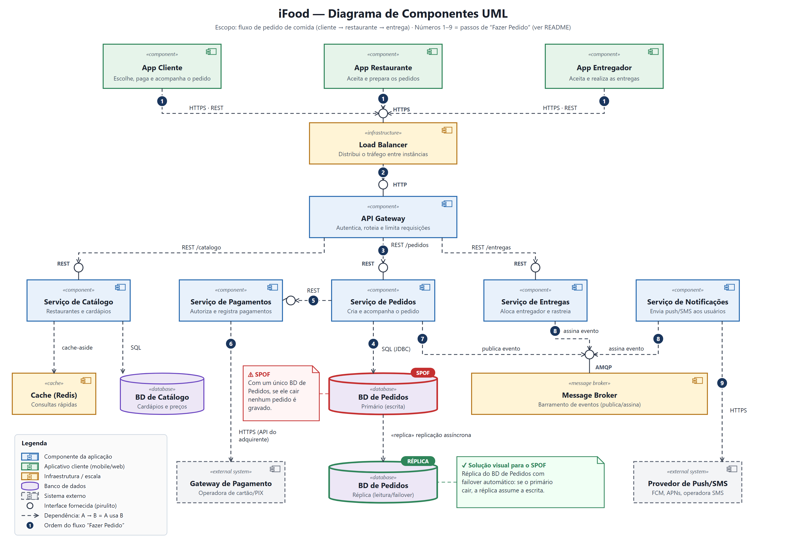

# Arquitetura de Software — Modelagem Visual de Componentes (iFood)

**Disciplina:** Arquitetura de Software · **Entregável:** Semana 01 — Modelagem Visual de Componentes

> Entrega 100% de modelagem visual: este repositório não contém código, apenas o diagrama de componentes UML e a documentação que o explica.

## Conteúdo do repositório

| Arquivo | Descrição |
|---|---|
| [`docs/diagrama-componentes.png`](docs/diagrama-componentes.png) | Diagrama exportado em imagem (alta resolução) |
| [`docs/diagrama-componentes.pdf`](docs/diagrama-componentes.pdf) | Diagrama exportado em PDF (vetorial) |
| [`docs/diagrama-componentes.svg`](docs/diagrama-componentes.svg) | Diagrama exportado em SVG (vetorial) |
| [`docs/diagrama-componentes.drawio`](docs/diagrama-componentes.drawio) | Fonte editável — abrir em [draw.io](https://draw.io/) |

---

## Parte 1 — Escopo e componentes

### Sistema escolhido e escopo

**Sistema:** iFood (plataforma de delivery de comida).
**Escopo:** apenas o **fluxo de pedido de comida** — o cliente escolhe um restaurante, faz o pedido, paga, o restaurante aceita e um entregador leva até o destino. Ficam de fora (para manter o diagrama simples): cadastro de usuários, cupons e promoções, avaliações, chat, painel financeiro do restaurante e programas de fidelidade.

### Componentes e responsabilidades

| Componente | Tipo | Responsabilidade |
|---|---|---|
| **App Cliente** | Aplicativo | Permite ao cliente navegar pelos restaurantes, montar a sacola, fazer o pedido, pagar e acompanhar o status. |
| **App Restaurante** | Aplicativo | Permite ao restaurante receber novos pedidos, aceitá-los ou recusá-los e informar que estão prontos. |
| **App Entregador** | Aplicativo | Permite ao entregador aceitar corridas, ver a rota e confirmar a retirada e a entrega. |
| **Load Balancer** | Infraestrutura | Recebe todo o tráfego externo e o distribui entre as instâncias do API Gateway, evitando sobrecarga e permitindo escalar horizontalmente. |
| **API Gateway** | Aplicação | Ponto único de entrada: valida a autenticação (token), aplica limite de requisições e roteia cada chamada para o serviço correto. |
| **Serviço de Catálogo** | Serviço | Responsável por restaurantes, cardápios, itens e preços. Atende consultas de leitura muito frequentes. |
| **Serviço de Pedidos** | Serviço | Cria o pedido, controla seu ciclo de vida (criado → pago → aceito → em entrega → entregue) e é o dono dos dados do pedido. |
| **Serviço de Pagamentos** | Serviço | Valida e autoriza o pagamento (ex.: cartão de crédito ou PIX) junto ao gateway de pagamento externo e registra o resultado. |
| **Serviço de Entregas** | Serviço | Escolhe e aloca o entregador disponível para um pedido confirmado e acompanha o andamento da entrega. |
| **Serviço de Notificações** | Serviço | Envia avisos (push/SMS) a cliente, restaurante e entregador a cada mudança importante do pedido. |
| **Cache (Redis)** | Infraestrutura | Guarda em memória cardápios e restaurantes mais consultados para responder rápido e aliviar o banco do catálogo. |
| **BD de Catálogo** | Banco de dados | Armazena de forma durável restaurantes, cardápios e preços. |
| **BD de Pedidos (primário)** | Banco de dados | Armazena de forma durável os pedidos e seus status; recebe todas as escritas. |
| **BD de Pedidos (réplica)** | Banco de dados | Cópia sincronizada do primário; assume o papel dele em caso de falha (veja o bônus). |
| **Message Broker** | Infraestrutura | Barramento de eventos (publica/assina): permite que o Serviço de Pedidos avise outros serviços sem precisar conhecê-los nem esperar por eles. |
| **Gateway de Pagamento** | Sistema externo | Operadora/adquirente que de fato processa cartão ou PIX. Não é desenvolvido pela equipe. |
| **Provedor de Push/SMS** | Sistema externo | Serviço de terceiros (ex.: FCM, APNs, operadora de SMS) que entrega as mensagens aos dispositivos. |

> Simplificação intencional: Pagamentos e Entregas também teriam seus próprios bancos de dados; foram omitidos do diagrama para mantê-lo de alto nível.

---

## Parte 2 — Como ler o diagrama (interfaces e conexões)

- **Retângulo com ícone de componente** (e estereótipo `«component»`) = componente do sistema. As cores indicam o papel: verde = aplicativo, azul = serviço, amarelo = infraestrutura, roxo (cilindro) = banco de dados, cinza tracejado = sistema externo.
- **Pirulito (círculo)** = *interface fornecida*: é a "porta" pela qual um componente oferece sua funcionalidade (ex.: o API Gateway oferece uma interface HTTP).
- **Seta tracejada** = *dependência*: a seta sai de quem **usa** e aponta para quem **é usado** (ex.: `App Cliente → Load Balancer`).
- **Números 1–9** = ordem dos passos do fluxo "Fazer Pedido" (descrito abaixo).

| De (consumidor) | Para (provedor) | Como se comunicam |
|---|---|---|
| App Cliente / App Restaurante / App Entregador | Load Balancer | HTTPS, API REST |
| Load Balancer | API Gateway | HTTP |
| API Gateway | Serviço de Catálogo, Pedidos e Entregas | REST (`/catalogo`, `/pedidos`, `/entregas`) |
| Serviço de Pedidos | Serviço de Pagamentos | REST (chamada síncrona: precisa da resposta para seguir) |
| Serviço de Pagamentos | Gateway de Pagamento (externo) | HTTPS (API do adquirente) |
| Serviço de Pedidos | BD de Pedidos | SQL (JDBC) |
| Serviço de Catálogo | Cache (Redis) e BD de Catálogo | cache-aside (consulta o cache; se faltar, vai ao banco) e SQL |
| Serviço de Pedidos | Message Broker | Publica evento (AMQP) |
| Serviço de Entregas / Serviço de Notificações | Message Broker | Assinam eventos (comunicação assíncrona) |
| Serviço de Notificações | Provedor de Push/SMS (externo) | HTTPS |
| BD de Pedidos (primário) | BD de Pedidos (réplica) | Replicação assíncrona |

---

## Parte 3 — Desafio

### Componentes de infraestrutura e escala adicionados

- **Load Balancer** na frente do API Gateway: divide as requisições entre várias instâncias do gateway; se uma cair, o tráfego segue pelas demais.
- **Cache (Redis)** ao lado do Serviço de Catálogo: cardápios são lidos milhares de vezes para cada vez que são alterados, então responder da memória reduz a latência e protege o banco.
- **Message Broker**: desacopla o Serviço de Pedidos dos serviços que reagem ao pedido (Entregas e Notificações). Se o Serviço de Notificações ficar lento ou fora do ar, o pedido continua sendo criado e as mensagens ficam na fila até serem consumidas.

### Fluxo narrado: o usuário clica em "Fazer Pedido"

1. O usuário, no **App Cliente**, clica em "Fazer Pedido". O app envia uma requisição HTTPS (`POST /pedidos`) ao **Load Balancer**.
2. O **Load Balancer** escolhe uma instância livre e encaminha a requisição ao **API Gateway**.
3. O **API Gateway** valida o token do usuário, aplica o limite de requisições e roteia a chamada para o **Serviço de Pedidos**.
4. O **Serviço de Pedidos** valida os dados e grava o pedido no **BD de Pedidos** com o status "aguardando pagamento".
5. O **Serviço de Pedidos** chama o **Serviço de Pagamentos** (REST) pedindo a autorização do pagamento.
6. O **Serviço de Pagamentos** envia a cobrança ao **Gateway de Pagamento** externo e devolve o resultado (aprovado ou recusado) ao Serviço de Pedidos, que atualiza o status do pedido.
7. Com o pagamento aprovado, o **Serviço de Pedidos** publica no **Message Broker** o evento "pedido confirmado" e responde ao app, que mostra "Pedido realizado!".
8. De forma assíncrona, o **Serviço de Entregas** (que assina o evento) começa a alocar um entregador, e o **Serviço de Notificações** (que também assina) prepara os avisos para o restaurante e para o cliente.
9. O **Serviço de Notificações** envia as mensagens ao **Provedor de Push/SMS**, que as entrega nos aparelhos. O restaurante vê o novo pedido no **App Restaurante** e o aceita pelo mesmo caminho (apps → Load Balancer → API Gateway → Serviço de Pedidos).

### Bônus — Ponto único de falha (SPOF) e solução visual

**SPOF identificado:** o **BD de Pedidos** com uma única instância. Se ele cair, o Serviço de Pedidos não consegue gravar nem consultar pedidos e todo o fluxo para — mesmo que todos os outros componentes estejam saudáveis. No diagrama ele está destacado em **vermelho**, com a etiqueta "SPOF" e uma nota explicativa.

**Solução proposta:** adicionar uma **réplica** do banco (em **verde** no diagrama), alimentada por replicação assíncrona, com **failover automático**: se o primário falhar, a réplica é promovida e passa a receber as escritas. A réplica também pode atender consultas de leitura, aliviando o primário.

**Observação:** o mesmo raciocínio vale para os demais componentes. O Load Balancer e o API Gateway já são tratados com múltiplas instâncias; Cache, Message Broker e BD de Catálogo também deveriam rodar em cluster em produção. Neste diagrama de alto nível destacamos apenas o ponto mais crítico do fluxo de pedido.

---

## Parte 4 — Reflexão

**Qual a importância de desenhar a arquitetura de um sistema antes de começar a codificar? Como o diagrama de componentes ajuda na comunicação entre a equipe técnica e os stakeholders (investidores, gerentes)?**

Desenhar a arquitetura antes de codificar é como fazer a **planta de uma casa antes de levantar as paredes**. Mudar uma linha em um desenho custa quase nada; mudar a posição de uma parede depois de construída custa tempo, dinheiro e retrabalho. Do mesmo modo, descobrir no diagrama que o banco de pedidos é um ponto único de falha, ou que o Serviço de Pedidos depende de um serviço de pagamento síncrono, é muito mais barato do que descobrir isso em produção, com clientes reais afetados.

A modelagem prévia traz três benefícios principais:

1. **Evita retrabalho:** as decisões grandes (quais são as partes, quem fala com quem, o que é síncrono ou assíncrono) são discutidas e corrigidas enquanto ainda são só desenhos.
2. **Alinha o entendimento de todos:** cada pessoa da equipe passa a ter a mesma imagem do sistema. Fica claro quem é responsável por quê, o que permite dividir o trabalho e desenvolver partes em paralelo sem que um componente invada a responsabilidade do outro.
3. **Prevê problemas de escala e de falha:** ao desenhar, perguntas naturais aparecem — "e se o tráfego dobrar?", "e se este serviço cair?". Foi assim que surgiram o Load Balancer, o Cache, o Message Broker e a réplica do banco neste diagrama.

Para a comunicação com **stakeholders** (investidores, gerentes, áreas de negócio), o diagrama de componentes funciona como uma **linguagem comum**: é visual, está em alto nível e dispensa conhecimento de código. Um gerente consegue ver, por exemplo, que o pagamento depende de um parceiro externo (um risco e um custo de contrato), que existe uma peça só para notificações (e quanto custaria evoluí-la) e onde o sistema precisa de investimento para crescer ou se tornar mais confiável. Para a equipe técnica, o mesmo desenho serve de referência nas discussões, na integração de novos membros e na documentação. Assim, decisões de prioridade, orçamento e prazo são tomadas com base em um entendimento compartilhado, e não em suposições.
